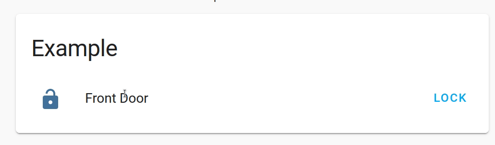

[](https://github.com/hacs/integration)
# onlylocklock

This project provides custom entity rows for locks, covers and alarm systems in Home Assistant.  The intent is to expose the locks/covers/alarm so that they can only be locked/closed/armed and not be unlocked/opened/disarmed through the ui.  This is good for wall tablets or for users with restricted access.

> **Note:** these rows only hide controls in the dashboard. They don't restrict what a user can do: anyone who can log in to Home Assistant can still unlock, open or disarm through other dashboards or the API.

The only lock lock row only allows the `lock` command to be called on a lock and prevents the more-info popup from being shown.  It looks like a normal lock row. Similarly, the only close cover row only allows the `close_cover` command to be called on a cover.  The only arm alarm row only allows `alarm_arm_home` or `alarm_arm_away` to be called on an alarm_control_panel.
# Usage
Add the type "custom:only-lock-lock-row" to your lock or "custom:only-close-cover-row" to your cover or "custom:only-arm-alarm-row" to your security system. All three rows take the same configuration: `entity` (required) and an optional `name`.  Note that the cover row is intended for, and only tested on, garage doors, but it should work with other cover types.

## Example
```yaml
entity: lock.front_door
type: custom:only-lock-lock-row
```
Or
```yaml
entity: cover.garage_door
type: custom:only-close-cover-row
```
Or
```yaml
entity: alarm_control_panel.house
type: custom:only-arm-alarm-row
```

### Inside an Entities Card Configuration
```yaml
type: entities
entities:
- entity: lock.front_door
  type: custom:only-lock-lock-row
```



# Roadmap
In general, the intended purpose of this is complete, outside of maintenance/cleanup.  However, there are some optional features I want to add.
- Add battery level icon next to lock
  - Requires setting a battery sensor entity per lock.
- Allow specific user to unlock and view the more info popup.
- Support theming?